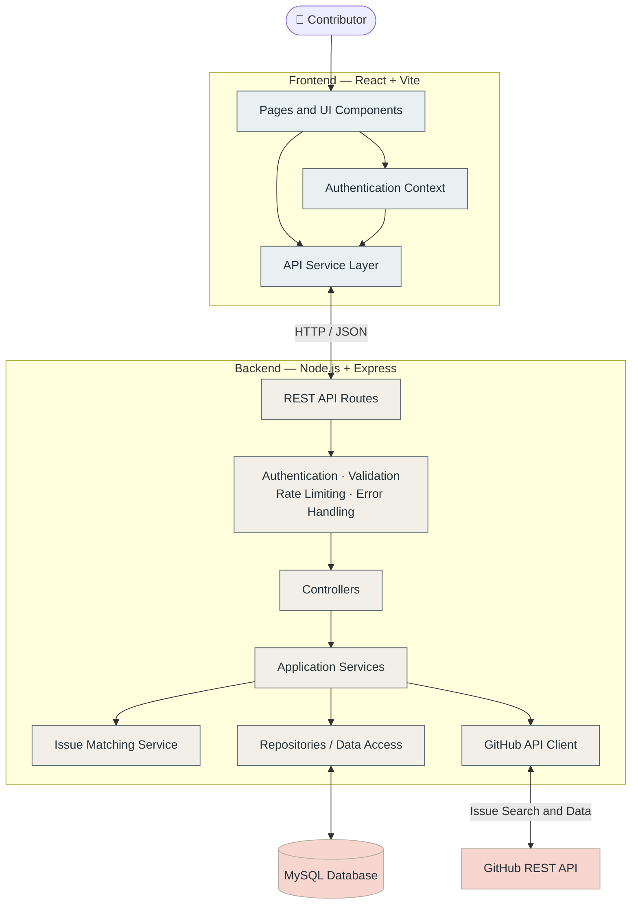

<div align="center">

# 🧭 ContribMap

### Find your next open-source contribution.

**Discover GitHub issues that match your skills, experience, and interests.**

ContribMap helps developers find meaningful open-source issues through skill-based matching, beginner-friendly filters, and personalized recommendations.

<br />


</div>

---

## 📌 Table of Contents

- [About ContribMap](#-about-contribmap)
- [The Problem](#-the-problem)
- [Our Solution](#-our-solution)
- [Features](#-features)
- [How Matching Works](#-how-matching-works)
- [System Architecture](#-system-architecture)
- [Technology Stack](#-technology-stack)
- [Project Structure](#-project-structure)
- [Getting Started](#-getting-started)
- [Environment Configuration](#-environment-configuration)
- [Database Setup](#-database-setup)
- [API Endpoints](#-api-endpoints)
- [Design System](#-design-system)
- [Security](#-security)
- [Current Scope](#-current-scope)
- [Future Enhancements](#-future-enhancements)
- [Contributing](#-contributing)
- [License](#-license)

---

## 🌍 About ContribMap

Open source provides incredible opportunities to learn, collaborate, and build real-world software. However, finding the right issue to work on can be challenging, especially for developers making their first contribution.

**ContribMap** is an open-source contribution discovery platform that connects developers with GitHub issues relevant to their technical skills and experience.

Instead of browsing hundreds of unrelated issues, contributors can create a profile, discover relevant opportunities, understand why an issue matches their skills, and save issues for later.

> **Our mission:** Make open-source contribution discovery simpler, smarter, and more accessible to everyone.

## ❗ The Problem

Developers who want to contribute to open source often face several challenges:

- 🔎 Finding relevant issues across numerous repositories.
- 🧩 Identifying issues that match their technical skills.
- 🌱 Discovering beginner-friendly opportunities.
- ⏳ Avoiding outdated or unsuitable issues.
- 📌 Keeping track of interesting issues and contribution progress.
- 🤔 Understanding whether an issue is a good fit before investing time in it.

## 💡 Our Solution

ContribMap brings issue discovery and personalized matching into one place.

1. **Build your profile:** Select your technical skills and preferences.
2. **Discover issues:** Search public GitHub issues through the GitHub REST API.
3. **Filter opportunities:** Narrow results by relevant criteria and beginner-friendly labels.
4. **Get matched:** Rank issues using a transparent matching score.
5. **Understand recommendations:** Review the reasons behind a match.
6. **Save issues:** Bookmark interesting opportunities and track their status.

## ✨ Features

### 👤 User Profiles

- User registration and login.
- Personalized developer profiles.
- Technical skill selection.
- Skill-based recommendations.

### 🔍 GitHub Issue Discovery

- Discover issues from public GitHub repositories.
- Search and filter available issues.
- View issue details and repository information.
- Open the original issue on GitHub.

### 🎯 Smart Matching

- Calculate a matching score for discovered issues.
- Consider technical skill overlap.
- Account for difficulty fit and beginner-friendly labels.
- Consider issue freshness.
- Explain why an issue may be relevant.

### 🔖 Bookmarks and Tracking

- Save interesting issues.
- View saved issues.
- Update contribution-tracking status.
- Remove bookmarks when they are no longer needed.

### 🛡️ Backend Infrastructure

- RESTful API architecture.
- Authentication middleware.
- Request validation.
- Rate limiting.
- Centralized error handling.
- MySQL-backed data access.

---

## 🧮 How Matching Works

ContribMap uses a weighted scoring model to rank issues according to contributor preferences.

| Matching factor | Weight |
|---|---:|
| Technical skill overlap | 50% |
| Difficulty fit | 20% |
| Beginner-friendly labels | 20% |
| Issue freshness | 10% |
| **Total** | **100%** |

### Matching formula

```text
Match Score =
    (Skill Overlap × 0.50)
  + (Difficulty Fit × 0.20)
  + (Beginner Labels × 0.20)
  + (Issue Freshness × 0.10)
```

Each factor is evaluated on a normalized scale, allowing the final score to be represented from 0 to 100.

**Example:** Suppose an issue receives these component scores:

| Factor | Component score | Weighted score |
|---|---:|---:|
| Skill overlap | 90 | 45 |
| Difficulty fit | 80 | 16 |
| Beginner labels | 100 | 20 |
| Freshness | 70 | 7 |
| **Final match score** | | **88/100** |

A higher score indicates a stronger match according to the configured criteria. It is a recommendation score, not a guarantee that a maintainer will accept a contribution.

---

## 🏗️ System Architecture

ContribMap follows a client-server architecture. The React frontend communicates with a Node.js and Express REST API. The backend coordinates authentication, matching, database operations, and GitHub issue discovery.



### Request lifecycle

1. A contributor interacts with the React interface.
2. The frontend API service sends a request to the Express backend.
3. Middleware processes authentication, validation, and request limits where applicable.
4. Controllers delegate the request to the appropriate application service.
5. Services retrieve or update application data and call the GitHub API when required.
6. The matching service ranks issues using the configured scoring model.
7. The API returns structured JSON to the frontend.
8. React displays the results to the contributor.

---

## 🛠️ Technology Stack

| Technology | Purpose |
|---|---|
| React | Component-based frontend |
| Vite | Frontend development server and build tooling |
| JavaScript | Application development |
| Node.js | Backend runtime |
| Express.js | REST API and routing |
| MySQL | Relational database |
| GitHub REST API | Public repository and issue discovery |
| JWT | Token-based authentication, where configured |
| CSS | Styling and responsive layouts |
| npm | Dependency management and scripts |

---

## 📂 Project Structure

```text
ContribMap/
│
├── client/
│   ├── src/
│   │   ├── components/
│   │   │   ├── common/
│   │   │   └── issues/
│   │   ├── context/
│   │   ├── hooks/
│   │   ├── pages/
│   │   ├── services/
│   │   ├── utils/
│   │   ├── App.jsx
│   │   └── index.css
│   ├── public/
│   └── package.json
│
├── server/
│   ├── src/
│   │   ├── config/
│   │   ├── controllers/
│   │   ├── integrations/
│   │   ├── middleware/
│   │   ├── repositories/
│   │   ├── routes/
│   │   ├── services/
│   │   ├── utils/
│   │   ├── validators/
│   │   ├── app.js
│   │   └── server.js
│   ├── tests/
│   └── package.json
│
├── .env.example
├── .gitignore
├── package.json
├── package-lock.json
├── README.md
└── LICENSE
```

*Note: The tree highlights the main application areas. Exact filenames and additional directories may differ slightly between versions.*

---

## 🚀 Getting Started

Follow these steps to run ContribMap locally.
